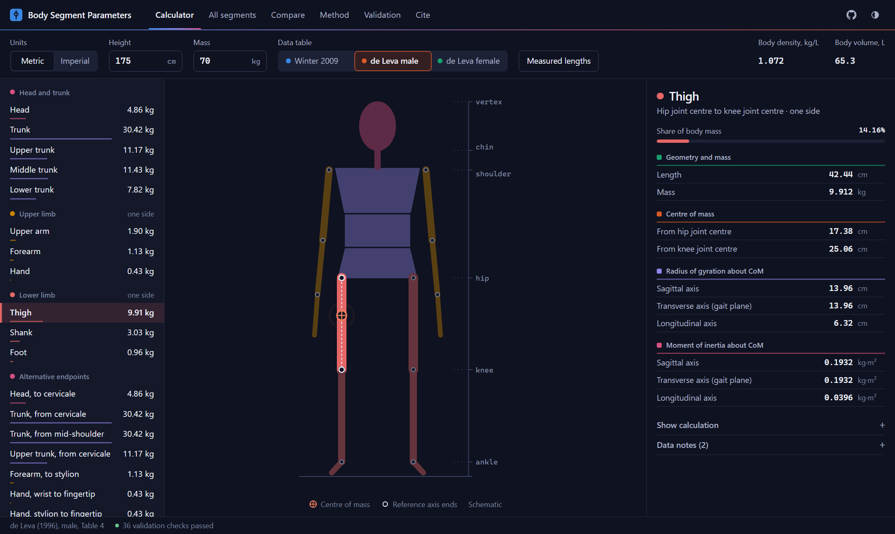

# Body Segment Parameters Calculator

[](https://github.com/anikait-kaushik/body-segment-calculator/actions/workflows/test.yml)
[](LICENSE)

Calculate body segment mass, centre of mass, radius of gyration and moment of inertia from height and mass, using two published tables: Winter (2009) and de Leva (1996), with separate male and female values.

**[Open the calculator](https://anikait-kaushik.github.io/body-segment-calculator/)**



## Features

- **Two published tables:** all 21 rows of Winter's Table 4.1, and all 21 rows of de Leva's Table 4 for males and females
- **Inertia on three axes** with de Leva: sagittal, transverse and longitudinal
- **Compare tab** to see how much the choice of table changes your results
- **Visible calculation** for every value of the selected segment
- **Measured lengths:** replace height-based estimates with your own marker or caliper data
- **Export** to CSV, JSON or the clipboard, with shareable links and a print layout
- **Private and portable:** one HTML file with no dependencies, no tracking and no network requests

## Quick start

Open the hosted page, or download [`index.html`](index.html) and open it in a browser. It also works offline.

## Choosing a table

| | Winter (2009) | de Leva (1996) |
| --- | --- | --- |
| Source data | Dempster's cadaver study (1955), compiled in Table 4.1 | Gamma-ray scans of living subjects (Zatsiorsky et al., 1990), adjusted to joint centres, Table 4 |
| Subjects | Eight elderly men | 100 men (mean age 24) and 15 women (mean age 19), Caucasian |
| Male and female values | No | Yes |
| Inertia | One planar value, about the centre of mass and both segment ends | About the centre of mass, on three axes |
| Segment lengths | Proportions of height, Figure 4.1 | Mean lengths, scaled in proportion to height |
| Density and volume | Fixed segment densities | Not given |

Report which table you used. For sagittal-plane analysis such as gait, use de Leva's **transverse** axis, which runs side to side. The sagittal axis runs front to back, and the longitudinal axis runs along the segment.

## Method

| Quantity | Equation |
| --- | --- |
| Segment mass | `m = (m/M) × M` |
| Centre of mass | `x = (x/L) × L` |
| Radius of gyration | `k = (k/L) × L` |
| Moment of inertia | `I = m k²` |
| Volume (Winter only) | `V = m / ρ` |
| Whole-body density (Winter, Eq. 4.2) | `d = 0.69 + 0.9c`, where `c = h / M^(1/3)` |

With de Leva, lengths are scaled as `L = (table length / table stature) × H`, using a stature of 1741 mm for males and 1735 mm for females.

### Winter reference lengths

Each ratio must be multiplied by the length the table defines it against. This is the easiest place to go wrong.

| Segment | L | Basis |
| --- | --- | --- |
| Hand | 0.108H | Figure 4.1 (approximate: wrist to fingertip) |
| Forearm | 0.146H | Figure 4.1 |
| Upper arm | 0.186H | Figure 4.1 |
| Forearm and hand | 0.146H | Table defines it from elbow to ulnar styloid |
| Total arm | 0.332H | Glenohumeral joint to ulnar styloid |
| Foot | 0.152H | Figure 4.1 (approximate: heel to toe) |
| Leg | 0.246H | 0.285H − 0.039H |
| Thigh | 0.245H | 0.530H − 0.285H |
| Foot and leg | 0.246H | Table defines it from femoral condyles to medial malleolus |
| Total leg | 0.491H | Greater trochanter to medial malleolus |
| Head and neck | 0.066H | **Estimate:** 0.936H − 0.870H, as Figure 4.1 does not label these landmarks |
| Shoulder mass | 0.129H | Figure 4.1 (approximate: measured from the midline) |
| Starred trunk rows | 0.288H | Table note: ratios use the greater trochanter to glenohumeral length, 0.818H − 0.530H |
| HAT to mid rib | 0.158H | Derived so it locates the same centre of mass as the 0.626 HAT row |

### Corrections and source inconsistencies

- **Winter, head and neck, proximal radius of gyration:** the 4th edition prints `0.116`. With the centre of mass at `1.000L`, this cannot be right. The parallel-axis theorem gives `√(0.495² + 1²) = 1.116`, so this tool uses `1.116`.
- **Winter, thorax and abdomen, centre of mass:** the table prints `0.63`, while mass-weighting the thorax and abdomen gives `0.671`. This tool keeps the printed value and reports the difference.
- **de Leva, Table 4 caption:** it prints the female stature as `173.5 m`. The correct unit is clear from the male entry and the data, so this tool uses 1735 mm.

## Validation

The calculation engine is tested against published values and physical identities:

- **Winter:** Examples 4.1, 4.6 and 4.7 and Problem 1 of Chapter 4, mass closure, and the parallel-axis theorem across all 26 tabulated radii of gyration about segment ends
- **de Leva:** mass closure, trunk parts summing to the trunk, and alternative-endpoint rows agreeing on the same centre of mass (within 0.04 mm) and radii of gyration (within 0.8%)
- **Transcription:** de Leva's table was read from the original paper and compared with [BMClab's independent transcription](https://github.com/BMClab/BMC/tree/master/data). All 210 shared values match. The 42 length values were read from the page image and confirmed against the PDF's text layer.

The same checks run live on the page under **Validation**. To run the tests yourself, with Node 20 or newer:

```bash
node --test
```

## Limitations

- Both tables give population averages, not values for an individual. Where accuracy matters, measure the subject directly, for example with DXA, or enter measured lengths.
- Neither table covers children or adjusts for age. Do not apply them to children.
- De Leva's female values rest on 15 subjects, and both tables have limited ethnic and body-type coverage.
- Segment densities are fixed values from Winter's table. The variation with body density in Winter's Figure 4.2 is not modelled, because the book gives it only as a graph.
- Scaling de Leva's lengths by height assumes the same body proportions at every height.
- The tables define segments differently, so compare them with care.
- This tool is for education and research. It is not a medical device.

## Contributing

Bug reports and pull requests are welcome. For a correction to the data, please cite the source and page. The engine sits in the `<script id="engine">` block in `index.html` and has no access to the page, so changes can be tested directly.

## Citation

Use GitHub's **Cite this repository** button, or see [`CITATION.cff`](CITATION.cff). Please also cite the table you used:

> Winter, D. A. (2009). *Biomechanics and Motor Control of Human Movement* (4th ed.). John Wiley & Sons.

> de Leva, P. (1996). Adjustments to Zatsiorsky-Seluyanov's segment inertia parameters. *Journal of Biomechanics*, 29(9), 1223-1230.

This project is independent and is not affiliated with the authors or publishers of these works.

## License

[MIT](LICENSE)
